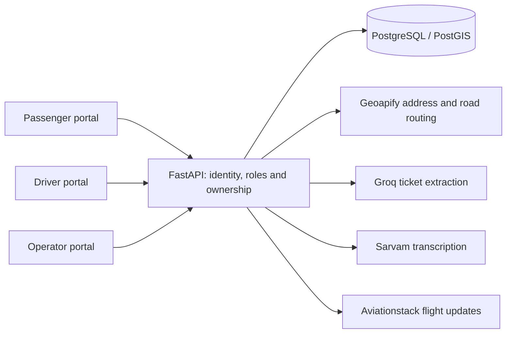

# kootu

**Land together. Leave together.**

Two people land at the same airport, minutes apart, and head toward the same neighbourhood. They have a shared journey ahead of them—but no simple way to find each other. kootu connects compatible arrivals with an approved driver, turning flight details into a coordinated shared ride.

[Open the demo](https://kootu-five.vercel.app) · [API health](https://kootu-api-k5eh.onrender.com/health) · [Build checks](https://github.com/krthik20050/kootu/actions) · [Submission](SUBMISSION.md)

Built from scratch for **DevDay Exchange Community Hackathon: Kochi, 10–11 October 2026**, with Codex assistance documented in [AI_USAGE.md](AI_USAGE.md). This is a deployed hackathon MVP, not a commercial transport service.

## From a ticket to a shared trip

1. **Choose your account.** Register as a passenger or a driver. The database remembers the choice; subsequent sign-ins open that account's workspace. Operator access is assigned separately.
2. **Tell us about your arrival.** Passengers upload a ticket or enter flight details, confirm the arrival and drop-off, and add their party's needs. Optional voice dictation becomes editable ride instructions.
3. **Find a compatible group.** The server checks timing, nearby destinations, road routes and vehicle capacity. No match means waiting—not a fabricated booking.
4. **Meet your driver.** An approved, available driver accepts an expiring offer and gets the assigned manifest. Passengers can see a fresh location pin when the driver chooses to share it.
5. **Complete the journey.** The driver starts and completes the trip; passenger status and history follow the persisted lifecycle.

**Payment in this MVP:** agree the fare with the driver and pay the driver directly. kootu does not quote fares, collect money, issue receipts, record payment settlement or calculate earnings. There is no pretend checkout or sample balance.

## What makes the coordination work

| Capability | Implemented behaviour |
| --- | --- |
| Separate portals | Passenger booking/dashboard; driver onboarding, vehicles, offers, trips and history; operator approval tools. Server-side roles and ownership checks protect API actions as well as the UI. |
| Ticket intake | Groq-assisted JPG/PNG/PDF extraction, including scanned PDFs up to three pages; editable review before saving. Unknown fields remain empty. |
| Voice instructions | Sarvam transcription appends to editable instructions. Structured accessibility and capacity inputs—not free-text guesses—control matching. |
| Flight-aware pickup | Aviationstack arrival lookup suggests landing plus 30 minutes. Polling handles provider-confirmed delays and cancellations; infeasible groups can return to matching. |
| Deterministic matching | Airport, ready/wait windows, whole-cluster destination proximity, road verification, seats, bags, women-only eligibility, wheelchair spaces, child seats and pets. Actual approved vehicle capacity is respected. |
| Persistent ride lifecycle | PostgreSQL/PostGIS stores accounts, requests, groups, offers, fleet and events. Stable request IDs and database locking protect retries and competing acceptance. |
| Driver operations | Operator approval of driver and vehicle, availability controls, expiring offers, assigned manifest, cancellation, start and completion. Approval records an operator decision; it does not automatically verify documents. |
| Location sharing | Assigned drivers opt in to device location sharing. Trip passengers get map/directions links; stale pins stop being actionable, and completion clears the location. |
| Privacy boundaries | Exact drop-offs and private notes are available to the assigned driver; other passengers receive aggregate group information. Raw ticket/audio uploads are transient. |
| Honest empty states | No invented journeys, identities, notifications or earnings. Synthetic fixtures remain in automated tests. |

## A short demo

Use separate passenger and driver accounts; changing the URL cannot change an account's role. If the signed-in role differs from the requested portal, an account-check screen explains the mismatch and offers sign-out/sign-in for the requested role instead of silently opening another dashboard. The homepage names both portal entries explicitly: passengers use `/dashboard` and drivers use `/driver`. A signed-in account sees its own named dashboard link. Driver vehicle registration lives under **Profile & vehicles**; the overview focuses on availability, fleet status and ride offers. The passenger overview provides **Plan a ride** and **Start with your ticket** entry points, a journey summary and history. Group, vehicle and pickup details appear when an active request exists; an unmatched request does not imply a scheduled pickup.

1. Register a driver, add a vehicle, and have the designated operator review and approve both at `/admin`. Set both available.
2. Register two passengers. Use `/request` for conversational intake or `/passenger` for ticket-guided intake. Conversational intake uses one page scroll and brings the active question into view as you advance. Confirm compatible upcoming arrivals and nearby drop-offs.
3. Save and find a group. A proposal requires an eligible vehicle and successful road verification; an empty result is a valid waiting state.
4. In the driver portal, accept the offer and review the manifest. Optionally share location over HTTPS with browser permission.
5. Start within the permitted pickup window, complete the trip, and inspect passenger/driver history. Explain the direct-payment policy rather than demonstrating a fake charge.

The live deployment uses Vercel, Render and Supabase, with a Clerk **development** instance for the hackathon. A cold backend can take about a minute to wake. Operator privileges are never granted to the first arbitrary sign-in.

## Architecture



Next.js 16 / React 19 / TypeScript power the frontend. FastAPI and SQLAlchemy own business logic and provider credentials. Clerk supplies bearer sessions; the backend validates issuer, signature and authorized origin. OpenAPI and TypeScript contracts are generated together.

`frontend/` owns the website; `backend/` owns services and tests; `database/migrations/` holds ordered SQL; `integrations/` documents providers; `docs/` contains deeper design and verification notes. Route groups `(user_app)` and `(driver_app)` organize files without adding URL segments.

## Run locally

Requirements: Node 22.12+, Python 3.13 recommended, PostgreSQL with PostGIS, and your own enabled provider/Clerk accounts. Do not reuse shared production data for tests.

In `backend` (PowerShell):

```powershell
python -m venv .venv
.\.venv\Scripts\python -m pip install -r requirements-dev.lock
.\.venv\Scripts\python -m pip install --no-deps -e .
Copy-Item .env.example .env
# Fill server-only settings; apply migrations with a migration-owner connection.
.\.venv\Scripts\python migrate.py
.\.venv\Scripts\python -m uvicorn app.main:app --reload --host 127.0.0.1 --port 8000 --no-access-log
```

In a second terminal, inside `frontend`:

```powershell
Copy-Item .env.example .env.local
npm ci
npm run dev
```

Open `http://localhost:3000` and use that exact origin in `FRONTEND_URL`. macOS/Linux use `cp` and `.venv/bin/python`. Copy examples only when creating your configuration; preserve existing configured files.

| Configuration | Required values |
| --- | --- |
| Frontend | `NEXT_PUBLIC_API_URL`, `NEXT_PUBLIC_AUTH_ENABLED=true`, `NEXT_PUBLIC_CLERK_PUBLISHABLE_KEY`, server-only `CLERK_SECRET_KEY` |
| Database/auth | `DATABASE_URL`, `CLERK_ISSUER`, `FRONTEND_URL`, `APP_ENV`; optional `CLERK_AUDIENCE`; designated `BOOTSTRAP_ADMIN_SUBJECT` for the operator |
| Routing | `ROUTING_PROVIDER=geoapify`, `GEOAPIFY_API_KEY`; Google routing remains an optional configured adapter |
| Ticket/voice/flights | `GROQ_API_KEY`, compatible `GROQ_MODEL`, `SARVAM_API_KEY`, `SARVAM_MODEL`, `AVIATIONSTACK_API_KEY` |

Apply all reviewed migrations, including `202610110006_account_roles.sql`, before running this version. Existing account roles are preserved; new accounts explicitly select a role. Runtime database access uses the dedicated API role, not the migration owner. See [database setup](docs/database.md) and [provider setup](integrations/README.md).

For this team's existing local setup, edit ignored `.environment/.env` and run `backend/.venv/Scripts/python scripts/sync_env.py` from the root; see [.environment/README.md](.environment/README.md). Hosted settings are configured separately. Never put provider/database secrets in `NEXT_PUBLIC_*` values.

## Check the software

In `frontend`: `npm run lint`, `npm run typecheck`, `npm test`, `npm run build`, `npm audit --omit=dev`.

In `backend`:

```powershell
.\.venv\Scripts\python -m ruff check .
.\.venv\Scripts\python -m ruff format --check .
.\.venv\Scripts\python -m pytest
.\.venv\Scripts\python export_contracts.py --check
```

Database tests require `TEST_DATABASE_URL` pointing to a **disposable** database whose name contains `test`. The suite drops/recreates its public schema and truncates tables. Never use the shared Supabase project. CI supplies PostgreSQL/PostGIS; without a test database, local database tests skip.

The suite covers matching, capacity/policy constraints, retries, competing operations, authorization, provider contracts and a ticket/voice → request → match → acceptance → manifest/location → completed-trip regression. That combined regression uses a real disposable database and stubbed external providers. It is not evidence of a physical microphone, GPS device or live provider journey. See [validation notes](docs/backend-validation.md) and current [CI results](https://github.com/krthik20050/kootu/actions).

After API changes, run `python export_contracts.py` and commit both generated outputs. Never hand-edit `frontend/src/lib/api/generated.ts`.

## Deployment and current limits

Vercel project root: `frontend`, install `npm ci`, build `npm run build`. Render root: `backend`, install locked runtime requirements and the package, then run `uvicorn app.main:app --host 0.0.0.0 --port $PORT --no-access-log`. Existing GitHub-connected services deploy main. Apply migrations separately before releasing; use a direct/session-pooled database connection for advisory locks, not transaction-mode pooling. The [Render blueprint](render.yaml) contains configuration names, not secrets.

- `/health` checks process availability; `/ready` checks configuration/database readiness. Neither proves provider credentials or an entire customer journey works.
- Render's free service sleeps after inactivity; flight maintenance runs only while the process is awake. Clerk development keys and this hosting setup are suitable for a hackathon demo, not a commercial launch.
- Provider availability, flight coverage, rate limits and account billing affect results. Matching is bounded coordination, not a guaranteed ride or optimal dispatch service.
- Target-device microphone/GPS, an authenticated hosted journey across multiple real accounts, and real-world pickup accuracy require separate validation. Do not infer those from automated fixtures.
- No payment processing, fare engine, emergency dispatch, automatic government-document verification or commercial operating procedures are implemented.

## Explore and contribute

[Frontend guide](frontend/README.md) · [Backend guide](backend/README.md) · [Database architecture](docs/database-architecture.md) · [Ticket/voice design](docs/ticket-voice-intake.md) · [Geoapify and location privacy](integrations/geoapify/README.md) · [Contributing](CONTRIBUTING.md) · [Changelog](CHANGELOG.md)

Use repository issues for implementation questions and bug reports; do not post credentials or passenger details. Participant attribution and the actual submitted commit belong in [SUBMISSION.md](SUBMISSION.md). The event permits at most four participants; the larger collaboration example in CONTRIBUTING does not change that rule.

## Sources and research

The product story follows the actual arrival-to-trip flow, without invented traction or savings claims. [GitHub's README guidance](https://docs.github.com/en/repositories/managing-your-repositorys-settings-and-features/customizing-your-repository/about-readmes) informed the why/what/how structure. [OWASP authorization guidance](https://cheatsheetseries.owasp.org/cheatsheets/Authorization_Patterns_Cheat_Sheet.html) informed server-side checks; [Render free-service limits](https://render.com/docs/free) and [Clerk environments](https://clerk.com/docs/guides/development/managing-environments) inform the deployment limitations. The [organizer's event page](https://luma.com/z10nz8gp) confirms the event and demo format; it does not publish a scoring rubric or promise a win.

Built with [Next.js](https://nextjs.org/docs), [Clerk](https://clerk.com/docs), [FastAPI](https://fastapi.tiangolo.com/), [SQLAlchemy](https://docs.sqlalchemy.org/en/20/), [PostGIS](https://postgis.net/documentation/), [Geoapify](https://apidocs.geoapify.com/), [Groq](https://console.groq.com/docs/vision), [Sarvam](https://docs.sarvam.ai/), [Aviationstack](https://aviationstack.com/documentation), [Vitest](https://vitest.dev/guide/) and [React Testing Library](https://testing-library.com/docs/react-testing-library/intro/). No external dataset or live credentials are bundled.
