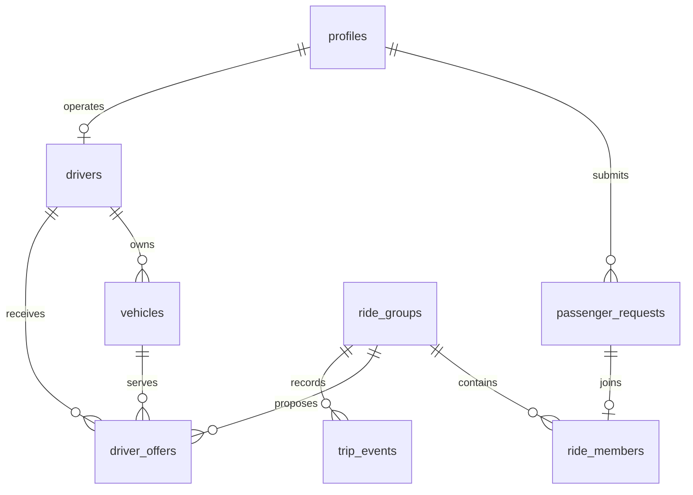

# Destination clusters and database architecture

Current implementation, 11 October 2026 (IST). This supersedes the initial four-seat/smallest-car policy in the earlier research report.

## Product rule

People leaving the same airport for the same destination area can share a car. For example, five or six separate passengers choosing nearby Thrissur city drop-offs may form one group if an approved vehicle can carry everyone and their luggage. Full names are not matching parameters. People travelling together under one account specify a party size.

The default policy now supports six passenger seats and six luggage pieces; actual vehicle limits always win. A four-seat car cannot receive a six-person offer. Operators can configure policy up to eight seats; this does not create vehicles or certify capacity. The existing frontend party-size control may remain more restrictive; six individual accounts can still form a six-person group.

City spelling is not sufficient evidence of proximity. Destinations remain confirmed map coordinates, with at most 3 km between every pair by geography and directed road checks. Thrissur and distant suburbs are not combined just because their text labels match. Same-flight preference is secondary to destination proximity; different flights can share when readiness windows overlap. No new full-route optimizer is required for this narrow clustering product.

## Data model

PostgreSQL/PostGIS is authoritative. FastAPI owns authenticated access and transactions; browser accounts do not query these tables directly. No cache, second datastore or ML model decides membership.

| Invariant | Enforcement |
| --- | --- |
| One logical submission despite retries | Client UUID plus account-row lock before lookup; different details for that UUID return 409 |
| One active booking for the same account/airport/flight date | API check and partial unique index `one_active_arrival_booking` |
| One request cannot belong to two groups | `ride_members.request_id` primary key |
| One driver/vehicle cannot serve two active trips | Existing partial unique indexes on ASSIGNED/IN_PROGRESS groups |
| Assigned vehicle belongs to that driver | Composite foreign keys on offers and groups |
| Available fleet must be approved | Database checks plus refreshed approval checks in application |
| Legal stored state, positive request version | Database CHECK constraints |
| Valid coordinates/capacity | Request validation and DB checks; generated geography point and GiST index |
| Proposal capacity and travel needs | Whole-group checks against actual vehicle, repeated on acceptance |
| Driver is not a passenger in their own car | Fleet query excludes member accounts and immutable capacity checks repeat exclusion |
| No success before persistence | API session commits before response; transaction conflicts roll back |

The active-booking rule is intentionally conservative: an account needing two distinct arrivals at the same airport on the same date must finish/cancel the first booking before making another. This avoids double assignment while flight delays mutate ready times. Different dates and airports remain allowed. Account identity is not proof that different accounts represent different physical people.

## Matching and concurrent commands

1. Use indexed same-airport, spatial, wait-window and policy filters before the 100-candidate cap.
2. Filter approved fleet by seed needs before the 30-vehicle cap; fetch drivers with vehicles to avoid per-vehicle queries. Among examined candidates prefer the group serving most passengers, then most parties, then fewer unused seats. This is bounded greedy allocation, not a global optimum.
3. Verify road compatibility outside the database transaction using immutable snapshots and a bounded attempt-local cache. Six-seat policy permits at most 30 directed calls; eight permits 56. Skip incompatible alternatives; never interpret missing road data as success.
4. Lock selected requests in ID order, compare versions/status, then lock driver and vehicle and revalidate. Create the group/members/offers/events atomically.
5. Lifecycle commands lock the group first, member requests in stable order, then driver/vehicle when needed. Competing accepts, cancellations, trip start and flight updates serialize on the group.
6. Database lock waits and connection-pool waits are bounded at five seconds; SQL statements at fifteen. Deadlock, serialization and lock-timeout conflicts return retryable 409 with `Retry-After: 1`. The caller retries the complete operation; there is no hidden replay of provider calls.

The same destination pair is checked in both road directions. A proximity chain A–B–C is insufficient if A and C are too far apart. The implementation intentionally retains whole-group checks instead of replacing them with density clustering. [PostGIS clustering semantics](https://www.postgis.net/docs/manual-3.5/en/ST_ClusterDBSCAN.html).

Consistent lock acquisition and whole-transaction retries follow PostgreSQL guidance. A constraint violation cannot be treated as successful work. [Explicit locking](https://www.postgresql.org/docs/17/explicit-locking.html), [serialization failure handling](https://www.postgresql.org/docs/17/mvcc-serialization-failure-handling.html), [partial uniqueness](https://www.postgresql.org/docs/17/indexes-partial.html).

## Resolved what-if cases

| Situation | Implemented response |
| --- | --- |
| Phone retries the same submit four times simultaneously | All successful retries identify the same stored request |
| Same account submits several new UUIDs for one arrival | One booking wins; the others get actionable 409 |
| Five passengers press Match together | Atomic version/lock checks permit one membership per request; losing attempts conflict or read the existing group |
| Four-seat and six-seat cars are both available | Prefer the feasible larger group; only fitting vehicles receive its offers |
| Two drivers accept one group, or one driver accepts two groups | Group/fleet locks and unique indexes prevent double assignment |
| Passenger cancels while driver accepts or starts | Commands serialize; started trips reject self-service cancellation |
| Flight response arrives after cancellation removed membership | Refresh membership and discard the old group reference; do not release a driver now serving elsewhere |
| Flight callback arrives after trip start | Ignore it for matching; never reshuffle a moving trip |
| Assigned pickup deadline expires | Cancel group, free fleet, retain still-feasible parties for rematching; expired waiting requests become CANCELLED |
| Passenger cancellation leaves at least two assigned parties | Recompute departure from the remaining parties' windows |
| Old flight lookups keep failing or return no data | Independent attempt timestamps rotate the bounded polling batch |
| Old live offers precede newer expired offers | Filter actionable groups before the expiry batch limit |
| App is deployed before schema | `/ready` validates mapped request columns and required arrival uniqueness index, not just table names |

Expiry uses the existing CANCELLED wire status to preserve frontend compatibility. `PICKUP_WINDOW_EXPIRED` distinguishes missed-pickup group events. Cleanup is periodic, so an expired request may remain visible until a maintenance cycle; acceptance/start still enforce the deadline immediately.

## Scaling limits and practical next steps

- Candidate/fleet and maintenance batches are bounded; this is not proof of arbitrary throughput. The synthetic test creates 200 bookings with eight concurrent submitters, then five competing match callers. It exercises correctness in that scenario, not 200 simultaneous HTTP connections or production capacity.
- Six-seat pooling is possible when enough users have submitted before a proposal. There is no mandatory accumulation delay or automatic enlargement of an already proposed group. Sparse demand can produce smaller groups; never delay someone past their own limit to fill a car.
- The initial fleet cap can still miss a better alternative. A different vehicle may fit a better road subset. Measure missed-match rate before widening the cap or adopting batch optimization.
- Provider latency/cost is separate from DB performance. Remaining improvements include per-flight coalescing, global quotas, whole-match deadlines and circuit breakers. Avoid blindly retrying every failed HTTP call.
- Maintenance still shares the API lifecycle. A sleeping free host cannot guarantee timely flight refresh or expiry. An awake worker and monitored backlog are necessary for operational SLAs; no paid infrastructure was added here.
- Queue indexes need realistic `EXPLAIN (ANALYZE, BUFFERS)` and workload measurement before claiming speedups. Account/profile locks isolate contention to one account; there is no global booking lock.
- Driver location, terminal access, real baggage volume, pickup confirmation, notifications and human support remain operating requirements. The app cannot create driver supply or guarantee a cab.
- Define retention and post-trip manifest access before broad rollout; do not copy passenger locations into general analytics. Deployment readiness does not verify external provider credentials.

## Migration and evidence

Ordered migrations 003 and 004 add the hardening constraints/attempt columns and active-arrival uniqueness/indexes. Historical violations cause migration failure, never automatic deletion. A schema-only backup was saved privately before hosted changes; no table data was exported. Both migrations were applied transactionally to the existing Supabase project on 11 October 2026. Runtime-role reads of the new columns, arrival-index validity and RLS on all nine application tables were verified.

Validation includes real disposable PostgreSQL/PostGIS tests, forced interleavings and the synthetic arrival burst. The deployable backend is tested from a source-only snapshot so concurrent teammate voice/PDF edits are excluded. Detailed final command results and GitHub rollout evidence are recorded in CHANGELOG.md. No test ever targets the hosted Supabase database.
